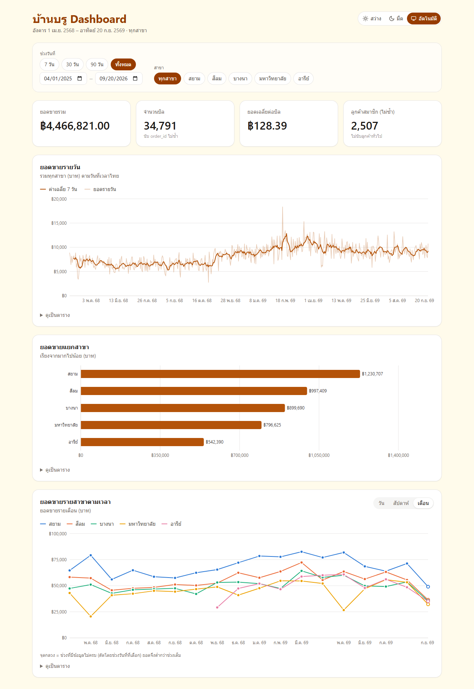
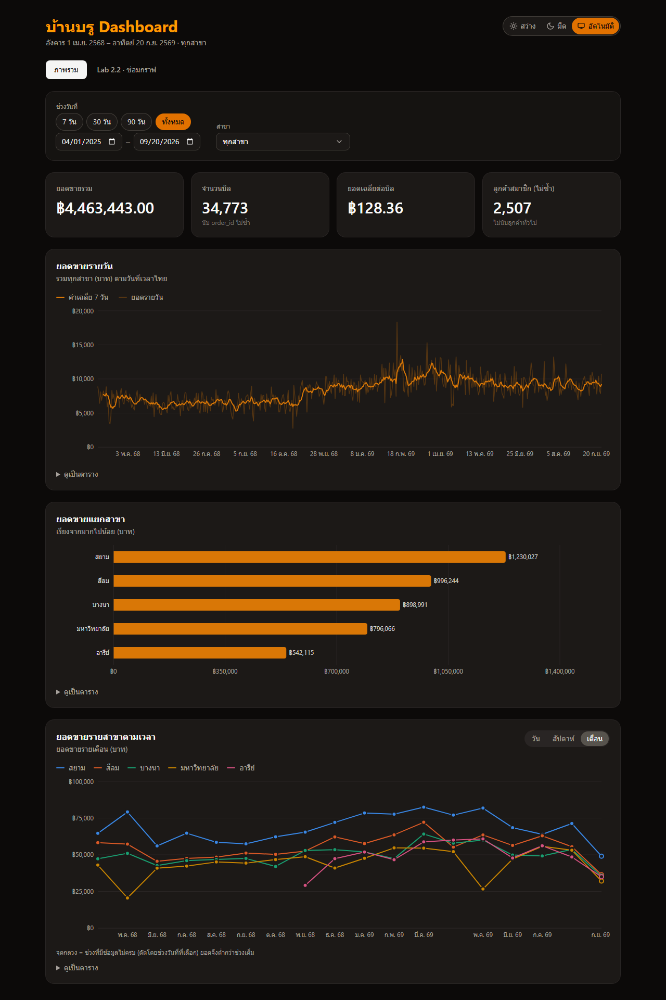
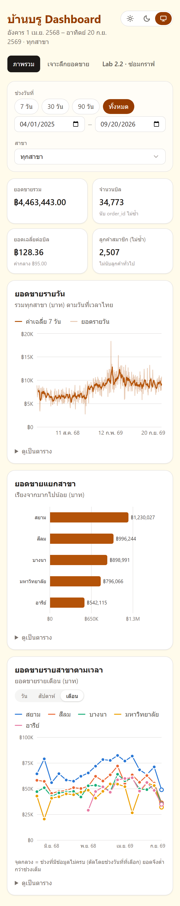
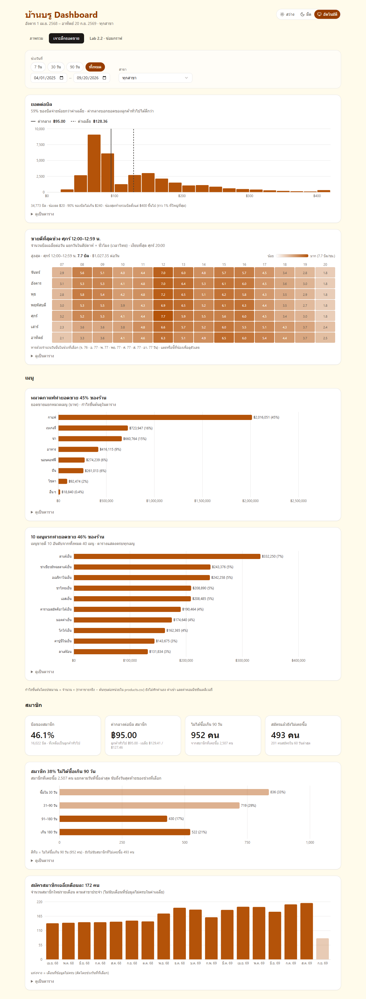
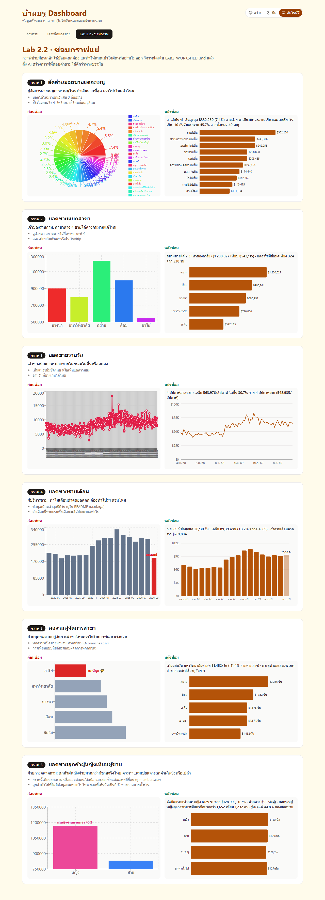

# บ้านบรู Dashboard

Dashboard สรุปยอดขายของร้านบ้านบรูจากไฟล์ `public/sales.csv` สร้างด้วย React + Vite + Tailwind CSS + Recharts

**ดูออนไลน์:** https://baanbrew-dashboard-weld.vercel.app/ (deploy บน Vercel อัปเดตอัตโนมัติทุกครั้งที่ push)

ข้อมูลครอบคลุม **1 เม.ย. 2568 – 20 ก.ย. 2569** จำนวน 53,057 แถว (34,773 บิล) จาก 5 สาขา



---

## ภาพหน้าจอ

<table>
  <tr>
    <th>โหมดมืด</th>
    <th>มือถือ (390px)</th>
  </tr>
  <tr>
    <td valign="top"></td>
    <td valign="top"></td>
  </tr>
</table>

**แท็บเจาะลึกยอดขาย** — การกระจายยอดต่อบิล (ค่ากลางเทียบค่าเฉลี่ย) heatmap จำนวนบิลตามวันในสัปดาห์ × ชั่วโมง ยอดขายแยกเมนู และส่วนสมาชิก



**แท็บ Lab 2.2 · ซ่อมกราฟ** — กราฟแย่ 5 แบบ (ซ้าย) เทียบกับกราฟที่ซ่อมแล้ว (ขวา) พร้อมข้อสรุปที่คำนวณจากข้อมูลจริง



ภาพทั้งหมดแสดงข้อมูลทั้งช่วง (ทุกสาขา) ถ่ายด้วย Chrome แบบ headless ที่ความกว้าง 1280px และ 390px ด้วยคำสั่ง `npm run screenshots` ([`scripts/screenshots.mjs`](scripts/screenshots.mjs))

---

## วิธีรัน

ต้องมี [Node.js](https://nodejs.org/) เวอร์ชัน 20.19 ขึ้นไป (พัฒนาด้วย 24.18)

```bash
npm install
npm run dev
```

แล้วเปิด http://localhost:5173

| คำสั่ง | ใช้ทำอะไร |
|---|---|
| `npm run dev` | เปิด dev server (แก้โค้ดแล้วหน้าเว็บอัปเดตทันที) |
| `npm run build` | build เป็นไฟล์สำหรับใช้งานจริงในโฟลเดอร์ `dist/` |
| `npm run preview` | เปิดดูผลจาก `npm run build` |
| `npm run lint` | ตรวจโค้ดด้วย oxlint |
| `npm run screenshots` | ถ่ายภาพหน้าจอใหม่ลง `docs/screenshots/` (ต้องเปิด `npm run dev` ไว้ก่อน และมี Chrome หรือ Edge ในเครื่อง) |

---

## ฟีเจอร์

**KPI 4 ตัว**
- ยอดขายรวม (บาท)
- จำนวนบิล
- ยอดเฉลี่ยต่อบิล (พร้อมค่ากลาง)
- จำนวนลูกค้าสมาชิกที่ไม่ซ้ำ

**กราฟ**
- **ยอดขายรายวัน**: กราฟเส้นยอดรายวัน (สีจาง) ทับด้วยเส้นค่าเฉลี่ยเคลื่อนที่ 7 วัน (สีเข้ม) เพื่อให้เห็นแนวโน้ม
- **ยอดขายแยกสาขา**: กราฟแท่งแนวนอน เรียงจากมากไปน้อย
- **ยอดขายรายสาขาตามเวลา**: กราฟเส้นแยกสาขา เลือกหน่วยได้ว่ารายวัน / รายสัปดาห์ / รายเดือน (เลือกให้อัตโนมัติตามช่วงวันที่)
- ทุกกราฟมี tooltip และปุ่ม "ดูเป็นตาราง" สำหรับอ่านตัวเลขทั้งหมด

**แท็บเจาะลึกยอดขาย** (`#insights` ใช้ตัวกรองชุดเดียวกับหน้าภาพรวม)
- **ยอดต่อบิล**: ฮิสโตแกรมช่องละ ฿20 พร้อมเส้นค่ากลาง (ทึบ) และค่าเฉลี่ย (ประ) หัวกราฟบอกสัดส่วนบิลที่ต่ำกว่าค่าเฉลี่ย (59%) เพราะยอดต่อบิลเบ้ขวา ค่าเฉลี่ยจึงไม่ใช่ยอดของลูกค้าทั่วไป บิลที่ใหญ่ที่สุดราว 1% รวมไว้ช่องสุดท้าย
- **วัน × ชั่วโมง**: heatmap จำนวนบิลเฉลี่ยต่อวัน (หารด้วยจำนวนวันนั้นในช่วงที่เลือก) หัวกราฟบอกช่วงที่ขายดีที่สุด ใช้วางกะพนักงานได้
- **เมนู**: ยอดขายแยกหมวด (หัวกราฟบอกหมวดที่ขายดีที่สุดและสัดส่วน) และ 10 เมนูขายดี ตารางแสดงครบทุกเมนู พร้อมจำนวน สัดส่วน และอัตรากำไรขั้นต้นโดยประมาณ
- **สมาชิก** (อ่านจาก `public/members.csv` ถ้าไม่มีไฟล์ ส่วนนี้จะไม่แสดง):
  - KPI: สัดส่วนบิลของสมาชิก, ค่ากลางต่อบิลสมาชิกเทียบลูกค้าทั่วไป, สมาชิกที่ไม่ได้ซื้อเกิน 90 วัน, สมัครแล้วยังไม่เคยซื้อ
  - สมาชิกแยกตามวันที่ซื้อล่าสุด (≤ 30 / 31–90 / 91–180 / > 180 วัน) นับถึงวันสุดท้ายของช่วงที่เลือก
  - จำนวนสมัครสมาชิกรายเดือน (เดือนที่ข้อมูลไม่ครบแสดงเป็นแท่งจาง)
  - เลือกสาขาแล้วนับตาม**สาขาประจำ**ของสมาชิก ส่วนการซื้อนับทุกสาขา

**ตัวกรอง**
- ช่วงวันที่: ปุ่มลัด 7 / 30 / 90 วัน / ทั้งหมด หรือเลือกวันเอง
- สาขา: listbox เลือกได้หลายสาขา (มีจุดสีตรงกับเส้นในกราฟรายสาขา) ใช้แป้นพิมพ์ได้ครบ: ↑/↓, Space/Enter, Home/End, Esc
- ตัวกรองมีผลกับ KPI และกราฟทุกตัวพร้อมกัน
- ตัวกรองถูกเก็บใน URL จึงรีเฟรชหรือแชร์ลิงก์ได้ และกดปุ่ม Back ของเบราว์เซอร์ย้อนได้ทีละขั้น
  ตัวอย่าง: `/?from=2026-08-22&branch=สยาม&branch=สีลม&g=week`

**อื่น ๆ**
- รองรับมือถือ (KPI เรียง 2 คอลัมน์ กราฟปรับขนาดตามจอ)
- โหมดสว่าง / มืด / อัตโนมัติตามเครื่อง

---

## ข้อมูล

ไฟล์ `public/sales.csv` (UTF-8) แปลงมาจาก `sales.xlsx` ต้นฉบับ มีคอลัมน์:

| คอลัมน์ | ความหมาย |
|---|---|
| `order_id` | เลขบิล — **1 บิลมีได้หลายแถว** (1 แถว = สินค้า 1 รายการ) |
| `datetime` | วันเวลาเวลาไทย เช่น `2025-04-01T18:48:40+07:00` |
| `branch` | สาขา: สยาม, สีลม, บางนา, มหาวิทยาลัย, อารีย์ |
| `product_id` | รหัสสินค้า (40 รายการ) |
| `qty` | จำนวน |
| `unit_price` | ราคาต่อหน่วย (บาท) |
| `customer_id` | รหัสสมาชิก — **ว่าง = ลูกค้าทั่วไป ไม่ใช่สมาชิก** |
| `payment_method` | QR พร้อมเพย์, บัตรเครดิต, เงินสด, LINE MAN, Grab |
| `channel` | หน้าร้าน, เดลิเวอรี |

ไฟล์เสริม (ไม่บังคับ ถ้าไม่มี ส่วนที่ใช้ไฟล์นั้นจะไม่แสดง):

| ไฟล์ | คอลัมน์ | ใช้ที่ |
|---|---|---|
| `public/members.csv` | `customer_id`, `joined_date`, `home_branch_id` | ส่วนสมาชิก |
| `public/branches.csv` | `branch_id`, `branch`, … | แปลง `home_branch_id` เป็นชื่อสาขา |
| `public/products.csv` | `product_id`, `product_name`, `category`, `cost`, … | ส่วนเมนู และแท็บ Lab 2.2 |

`members.csv` ตัดมาจาก `customers.csv` เหลือเฉพาะ 3 คอลัมน์ที่ใช้ **ไม่มีชื่อเล่น เบอร์โทร เพศ หรืออายุ** เพราะไฟล์ใน `public/` ดาวน์โหลดได้จากเว็บที่ deploy แล้ว

> ไฟล์ `sales.xlsx` ไม่ได้อยู่ใน repository (อยู่ใน `.gitignore`) เพราะ dashboard อ่านจาก `sales.csv` อย่างเดียว

---

## นิยามตัวชี้วัด

การคำนวณทั้งหมดอยู่ใน [`src/lib/metrics.js`](src/lib/metrics.js) แยกจากส่วนแสดงผล

| ตัวชี้วัด | สูตร |
|---|---|
| ยอดขายของแถว | `qty × unit_price` |
| ยอดขายรวม | ผลรวมยอดขายของทุกแถว |
| จำนวนบิล | จำนวน `order_id` ที่**ไม่ซ้ำ** (ใช้ `Set`) |
| ยอดเฉลี่ยต่อบิล | ยอดขายรวม ÷ จำนวนบิล |
| ลูกค้าสมาชิกไม่ซ้ำ | จำนวน `customer_id` ที่ไม่ว่างและไม่ซ้ำ |
| ค่าเฉลี่ย 7 วัน | ยอดของวันนั้นรวมกับ 6 วันก่อนหน้า ÷ 7 |
| ค่ากลางยอดต่อบิล | ค่ากลางของยอดรวมแต่ละบิล (quantile แบบ linear interpolation เหมือน pandas) |
| บิลต่อวันใน heatmap | จำนวนบิลในวันนั้น × ชั่วโมงนั้น (เวลาไทย) ÷ จำนวนวันนั้นในช่วงที่เลือก |
| กำไรขั้นต้นของเมนู (ประมาณ) | `qty × (unit_price − cost)` ใช้ราคาขายจริงในบิล และต้นทุนต่อหน่วยจาก `products.csv` ยังไม่หักค่าแรง ค่าเช่า และค่าคอมมิชชันเดลิเวอรี |
| สัดส่วนบิลของสมาชิก | บิลที่มี `customer_id` ÷ จำนวนบิลทั้งหมด ในช่วงที่เลือก |
| ไม่ได้ซื้อเกิน 90 วัน | สมาชิกที่เคยซื้อ และวันซื้อล่าสุดห่างจากวันสุดท้ายของช่วงที่เลือกเกิน 90 วัน |
| สมัครแล้วยังไม่เคยซื้อ | สมาชิกที่สมัครไม่เกินวันสุดท้ายของช่วง แต่ไม่มีบิลเลยจนถึงวันนั้น |

**ทำไมต้องนับ `order_id` ไม่ซ้ำ ไม่ใช่นับแถว:** บิลโดยเฉลี่ยมี 1.53 รายการ ถ้านับแถวจะได้ 53,057 "บิล" (เกินจริง 53%) และยอดเฉลี่ยต่อบิลจะเหลือ ฿84.13 แทนที่จะเป็น ฿128.36 (ต่ำกว่าจริง 34%)

| จำนวนรายการในบิล | จำนวนบิล |
|---|---|
| 1 | 21,473 |
| 2 | 9,401 |
| 3 | 2,814 |
| 4 | 1,085 |

### ฟังก์ชันหลักใน `metrics.js`

| ฟังก์ชัน | หน้าที่ |
|---|---|
| `parseSales(csvText)` | อ่าน CSV ด้วย PapaParse, แปลงตัวเลข, ข้ามแถวที่ข้อมูลไม่ครบ |
| `toBangkokDate(datetime)` | แปลงเวลาเป็นวันที่ตามเวลาไทย (รองรับเวลาที่มี offset อื่น เช่น UTC) |
| `computeKpis(rows)` | คำนวณ KPI ทั้ง 4 ตัว |
| `dailySales(rows, range)` | ยอดรายวัน — วันที่ไม่มียอดขายเติมเป็น 0 |
| `movingAverage(daily, 7)` | ค่าเฉลี่ยเคลื่อนที่ — 6 วันแรกเป็น `null` เพราะข้อมูลยังไม่ครบ 7 วัน |
| `salesByBranch(rows)` | ยอดแยกสาขา เรียงมาก→น้อย |
| `branchSalesOverTime(rows, …)` | ยอดแต่ละสาขาต่อ วัน/สัปดาห์/เดือน |
| `billDistribution(rows)` | ฮิสโตแกรมยอดต่อบิล + ค่าเฉลี่ย ค่ากลาง percentile 90 |
| `weekdayHourHeatmap(rows, …)` | จำนวนบิลและยอดเฉลี่ยต่อวัน แยกวันในสัปดาห์ × ชั่วโมง |
| `menuSales(rows, products)` | ยอดขาย จำนวน และกำไรขั้นต้นแยกเมนูและหมวด |
| `parseMembers(csvText, branchNames)` | อ่าน `members.csv` และแปลงรหัสสาขาเป็นชื่อ |
| `memberInsights(rows, rangeRows, members, …)` | เทียบบิลสมาชิก/ลูกค้าทั่วไป, วันที่ซื้อล่าสุด, ไม่เคยซื้อ, สมัครรายเดือน |
| `filterRows(rows, …)` | กรองตามสาขาและช่วงวันที่ |

---

## การตัดสินใจสำคัญในการออกแบบ

- **ค่าเฉลี่ย 7 วันเมื่อกรองวันที่:** คำนวณจากข้อมูลทั้งหมดก่อน แล้วค่อยตัดตามช่วงที่เลือก วันแรกของช่วงจึงยังมีค่าเฉลี่ยที่ถูกต้อง (ใช้ยอดของวันก่อนหน้าช่วงมาคิด)
- **สาขาที่ยังไม่เปิดไม่ถูกวาดเป็น 0:** สาขาอารีย์เริ่มมียอดขายวันที่ 1 พ.ย. 2568 ช่วงก่อนหน้านั้นจึงไม่มีเส้น (tooltip แสดง "ยังไม่เปิด") ถ้าวาดเป็น 0 จะดูเหมือนสาขาขายไม่ได้
- **ช่วงเวลาที่ข้อมูลไม่ครบ:** เช่น ก.ย. 2569 ที่มีข้อมูลแค่ 20 วัน แสดงเป็นจุดกลวง และ tooltip บอกว่ามีข้อมูลกี่วัน ยอดที่ต่ำลงจึงไม่ถูกอ่านว่ายอดตก
- **สีประจำสาขาคงที่:** กรองสาขาออกแล้ว สาขาที่เหลือยังเป็นสีเดิม ชุดสีผ่านการตรวจความแตกต่างสำหรับผู้ที่ตาบอดสี ทั้งโหมดสว่างและมืด
- **ความเร็ว:** ปุ่มตัวกรองตอบสนองทันที ส่วนกราฟคำนวณตามหลัง (`useDeferredValue`) และตาราง "ดูเป็นตาราง" สร้างเฉพาะตอนกดเปิด

---

## การตรวจสอบความถูกต้อง

ตัวเลขใน dashboard ถูกเทียบกับการคำนวณแยกจาก CSV โดยตรง (Python / Node.js / awk):

| ตรวจอะไร | ผล |
|---|---|
| ยอดรวม / จำนวนบิล / สมาชิก ทั้งชุดข้อมูล | ฿4,463,443.00 / 34,773 / 2,507 ตรงกัน |
| กรอง 30 วันล่าสุด + สาขาสยาม | ฿71,041 / 540 บิล / ฿131.56 / 224 คน ตรงกัน |
| ค่าเฉลี่ย 7 วันของวันแรกในช่วงที่กรอง | ฿2,318.43 ตรงกัน |
| ผลรวมทุกเดือนทุกสาขา | เท่ากับยอดรวมทั้งหมด |
| วันที่เวลา UTC ข้ามเที่ยงคืน, ราคาที่มีจุลภาค, แถวเสีย | ทดสอบด้วยข้อมูลตัวอย่างที่คิดคำตอบไว้ล่วงหน้า ถูกต้อง |

---

## ข้อสังเกตเรื่องคุณภาพข้อมูล

ในบิลที่มีหลายรายการ (13,300 บิล) พบว่า:

- **10,010 บิล (75%)** มี `payment_method` มากกว่า 1 แบบในบิลเดียว
- **4,964 บิล (37%)** มี `channel` มากกว่า 1 แบบในบิลเดียว เช่น บางรายการเป็น "หน้าร้าน" บางรายการเป็น "เดลิเวอรี"
- ส่วน `branch` และ `customer_id` ตรงกันทุกแถวในบิลเดียวกัน และ `datetime` ตรงกันถึงระดับนาที (296 บิลต่างกันแค่วินาที เพราะตอนทำความสะอาด แถวที่ต้นฉบับไม่มีวินาทีถูกเติมเป็น `:00`)

ตัวอย่าง บิล `ORD0000011` มี 3 รายการ ชำระด้วย บัตรเครดิต, QR พร้อมเพย์ และ Grab และมีทั้งหน้าร้านและเดลิเวอรี

ในความเป็นจริงบิลหนึ่งควรชำระด้วยวิธีเดียวผ่านช่องทางเดียว จึงน่าจะเป็นปัญหาจากต้นทางข้อมูล **dashboard นี้จึงยังไม่มีการวิเคราะห์ตามวิธีชำระเงินหรือช่องทางขาย** ถ้าจะวิเคราะห์ ต้องตกลงก่อนว่าจะใช้ค่าใดเป็นค่าของบิล

---

## โครงสร้างโปรเจกต์

```
docs/screenshots/           ภาพหน้าจอที่ใช้ใน README
scripts/
  screenshots.mjs           สคริปต์ถ่ายภาพหน้าจอ (npm run screenshots)
public/
  sales.csv                 ข้อมูลขาย
  members.csv               สมาชิก (customer_id, joined_date, home_branch_id)
  branches.csv / products.csv  ข้อมูลสาขาและเมนู
src/
  App.jsx                   หน้าหลัก: โหลดข้อมูล, ตัวกรอง, ประกอบ KPI และกราฟ
  lib/
    metrics.js              การคำนวณทั้งหมด
    format.js               รูปแบบตัวเลข (฿1,234.50) และวันที่ภาษาไทย
    urlFilters.js           แปลงตัวกรอง ⇄ URL
    theme.js                โหมดสว่าง/มืด
    chartTheme.js           สีของกราฟแต่ละธีม
  hooks/
    useMediaQuery.js        ตรวจขนาดจอ (มือถือ)
  components/
    KpiCard.jsx
    FilterBar.jsx
    ThemeToggle.jsx
    ChartCard.jsx           กรอบการ์ดกราฟ + ตารางแบบพับได้
    ChartTooltip.jsx
    DailySalesChart.jsx     ยอดขายรายวัน + ค่าเฉลี่ย 7 วัน
    BranchSalesChart.jsx    ยอดขายแยกสาขา
    BranchTrendChart.jsx    ยอดขายรายสาขาตามเวลา
    BillDistributionChart.jsx  การกระจายยอดต่อบิล (แท็บเจาะลึกยอดขาย)
    WeekdayHourHeatmap.jsx  heatmap วัน × ชั่วโมง (แท็บเจาะลึกยอดขาย)
    MenuSection.jsx         ยอดขายแยกหมวดและ 10 เมนูขายดี (แท็บเจาะลึกยอดขาย)
    MemberSection.jsx       ส่วนสมาชิก: KPI + วันที่ซื้อล่าสุด + สมัครรายเดือน (แท็บเจาะลึกยอดขาย)
  lab2/                     แท็บ Lab 2.2 · ซ่อมกราฟ
```

## เทคโนโลยี

React 19 · Vite 8 · Tailwind CSS 4 · Recharts 3 · PapaParse 5 · oxlint
